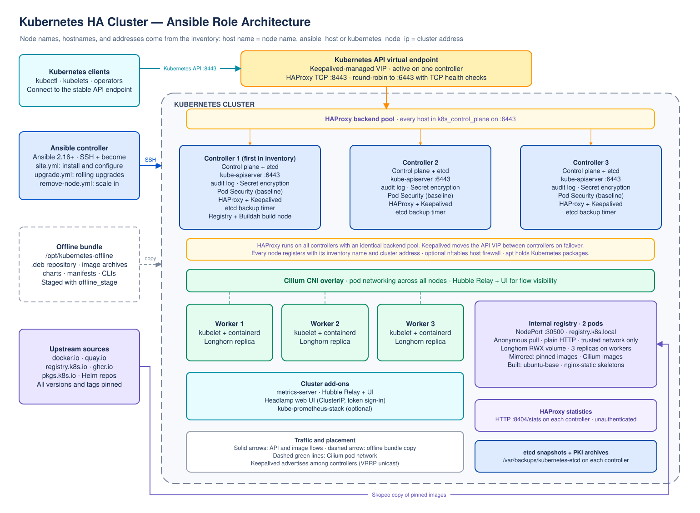

# ansible-role-kubernetes

An Ansible role for installing a Kubernetes cluster with containerd, Cilium,
HAProxy and Keepalived on the control-plane nodes, plus an internal Docker
Distribution registry backed by replicated Longhorn storage. The role resolves
the latest stable Kubernetes, Cilium, and Longhorn releases at runtime.

> **Before you run this role:** replace all `changeme` values, configure your
> inventory and API virtual IP, review the network requirements, and keep
> credentials in Ansible Vault. Do not commit real passwords or vault secrets.

## Requirements

- Ansible Core 2.16 or newer on the Ansible controller.
- Debian-family managed hosts with `apt`, Python, SSH access, and privilege
  escalation to root.
- At least one control-plane node and one worker node. For a highly available
  control plane, use three control-plane nodes.
- All nodes must be able to reach each other and the required package/image
  repositories. Longhorn additionally requires iSCSI and NFSv4 client support
  and sufficient local disk space under `/var/lib/longhorn` on at least three
  worker nodes. Permit Longhorn's node-to-node storage traffic through host
  firewalls as described in its [network requirements](https://longhorn.io/docs/latest/deploy/important-notes/#networking).
- A free virtual IP address on the control-plane network for Keepalived.

## Architecture



The editable diagrams.net source is [docs/architecture.drawio](docs/architecture.drawio).
The API virtual IP is active on one controller at a time; HAProxy on that
controller distributes new TCP connections round-robin across healthy API
servers. Cilium provides pod networking across the cluster.

## Configure before running

1. **Inventory:** Copy `examples/inventory.yml` to your own inventory and
   replace every documentation-only address (`192.0.2.x`) with the real
   reachable IPv4 address of each host. Keep the hostnames consistent with the
   control-plane and worker groups.
2. **SSH and sudo credentials:** Copy
   `examples/group_vars/all.yml.example` to `examples/group_vars/all.yml`.
   Replace `changeme` with the SSH username and credentials for your hosts.
   Encrypt the file with Ansible Vault before storing real credentials:

   ```sh
   ansible-vault encrypt examples/group_vars/all.yml
   ```

   Use `--ask-vault-pass` when running the playbook, or configure a secure vault
   password source. Do not put real passwords directly in the playbook or
   commit unencrypted credentials.
3. **API endpoint:** In `examples/site.yml`, set
   `kubernetes_api_vip` to an unused address in your controller subnet and set
   `kubernetes_api_vip_prefix` and `kubernetes_api_vip_interface` for your
   network. The default API VIP listener port is `8443`; it forwards to each
   controller's kube-apiserver on `6443`.
4. **Keepalived:** Replace the `changeme` value for
   `kubernetes_keepalived_auth_pass` with a shared secret of at most eight
   characters. Keep it private; the default is intentionally rejected by the
   role's preflight check.
5. **Network ranges:** Review the pod and service CIDRs in
   `defaults/main.yml`. They must not overlap each other, node networks, or
   routes reachable by your cluster.
6. **Firewall and exposure:** Allow the Kubernetes control-plane and node
   traffic required by your environment, TCP `8443` to the API VIP, TCP `6443`
   to controller API servers, and Keepalived VRRP/unicast traffic between
   controllers. The HAProxy statistics page is unauthenticated on TCP `8404`;
   restrict it to trusted administrator networks.

The registry uses a Longhorn `ReadWriteMany` volume with three replicas by
default, and runs two registry pods. The default claim size is 8 GiB; with
three replicas, allow about 24 GiB of raw capacity across the storage nodes.
Set `kubernetes_longhorn_replica_count` and
`kubernetes_registry_storage_size` to match your capacity and durability
requirements. Longhorn CSI, manager, and engine-image components run on
controllers so workloads there can mount and attach volumes, but controller
disks are excluded from replica placement. Replicas stay on separate workers.
Two registry pods are scheduled on different nodes. A single controller failure
does not lose the registry volume, provided the Longhorn prerequisites are met
and healthy replicas exist on surviving nodes; volume/share-manager
reattachment can cause a brief interruption while Kubernetes and Longhorn
recover.

On an existing cluster, the first registry deployment with Longhorn detects
the old hostPath deployment, briefly scales it down, and copies its data from
the first control-plane node to the replicated volume before switching the
registry to two pods. Run this migration while that controller and its old
registry data are available; the old copy is left untouched. If that host or
its disk is already lost, data that existed only there cannot be recovered by
this migration.

The registry is exposed as a plain-HTTP NodePort (`30500`) without
authentication. Do not expose it outside a trusted network.

## Install and run

Install the role from the public GitHub repository:

```sh
ansible-galaxy role install git+https://github.com/636B65/ansible-role-kubernetes.git
```

Copy and edit the example files as described above, then run:

```sh
ansible-playbook -i examples/inventory.yml examples/site.yml \
  --ask-vault-pass
```

For a local checkout, install the current directory into a local roles path
first:

```sh
ansible-galaxy role install . --roles-path ./roles
ANSIBLE_ROLES_PATH=./roles ansible-playbook \
  -i examples/inventory.yml examples/site.yml --ask-vault-pass
```

The role uses privilege escalation on managed hosts. Set `become` in your
playbook and provide the appropriate become password through Vault or another
secret manager.

## Selective task tags

Use tags to run only the relevant part of the role. `registry_deploy` includes
Longhorn installation and the one-time data migration from the old hostPath
registry; run it while the first control-plane node is available:

| Tag | Tasks |
| --- | --- |
| `prerequisites` | OS preparation, containerd and Kubernetes packages |
| `loadbalancer` | HAProxy and Keepalived configuration on control-plane nodes |
| `bootstrap` | Initialize the first controller and install Cilium |
| `join` | Join additional control-plane and worker nodes |
| `longhorn` | Install Longhorn and prepare replicated storage prerequisites |
| `registry_deploy` | Install Longhorn, migrate existing data if needed, and deploy two registry replicas |
| `registry_runtime` | Configure containerd for the registry |
| `registry_images` | Copy configured images into the registry |
| `registry` | Run Longhorn installation and all registry tasks |

Example:

```sh
ansible-playbook -i examples/inventory.yml examples/site.yml \
  --tags loadbalancer --ask-vault-pass
```

## Versioning and releases

Kubernetes and Cilium stable versions are discovered at playbook runtime. This
tracks current stable releases but is not reproducible by default; pin package
and Cilium versions in a controlled environment if repeatable deployments are
required.

Push a version tag such as `v1.0.0` to run the CI checks and publish a GitHub
Release. The release workflow requires the repository's standard
`GITHUB_TOKEN` permission to create releases.
